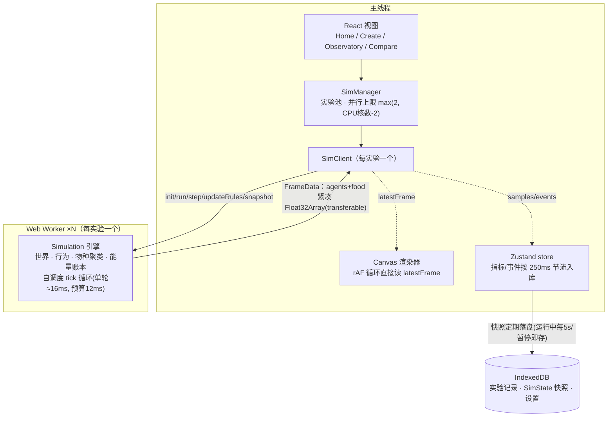

# Genesis Lab · 创世实验室

在浏览器里创造人工生命世界：写下一句创世描述，撒下一把生命，运行演化模拟，观察涌现行为，并在任意时刻分叉出平行世界，对比不同规则下的命运。纯前端应用，无后端——模拟跑在 Web Worker 里，数据存在 IndexedDB 里。

技术栈：React 18 · TypeScript · Vite · Zustand · ECharts · Tailwind CSS 4 · idb。模拟引擎为无依赖的纯 TypeScript 模块。

## ✨ 功能亮点

- **物种叙事与世界报告** — 新物种分化时由基因组按现实生物命名惯例自动命名：中文俗名「大青鹿」「尖牙鼬」（形体+颜色+类群，颜色即画布外观）配拉丁双名 *Cervus ferox*；附带特征标签、一句话生态位与世系。事件流播报分化、灭绝讣告（存续时长 · 巅峰数量）、权力更迭、饥荒与演化纪录；指标页顶部是六节「世界报告」：总览数据、种群与资源、势力格局、基因漂变、物种兴衰、大事记。
- **有性繁殖与谱系树** — 求偶（感知内最近的同类成熟个体）+ 基因均匀交叉 + 突变，双亲各投 25% 体能孕育后代（可在规则面板随时切回无性）；「谱系」页把全部物种的分化历史画成时间轴系统发生树，灭绝种标 †、节点联动画布高亮。
- **因果透视与热力叠加** — 死因账本（饿死/被捕杀/衰老/危险区/瘟疫）与物种对捕杀矩阵进报告；物种传记下钻页展示单支物种的完整历史；画布可切换 种群密度/死亡热点 热力叠加，看懂哪里扎堆、哪里在死人。
- **自然语言创世** — 一句话描述（如「贫瘠的荒漠，有两只凶猛的猎手」）生成完整 WorldSpec；配置任意 OpenAI 兼容接口即可调用 LLM，不配置则退回内置离线规则解析，离线照样可用。
- **分叉实验** — 任意时刻把当前世界快照复制成平行实验，改一条规则再跑；子实验继承分叉前的历史曲线，首页以家族树呈现实验谱系。
- **确定性引擎** — 种子化 PRNG，只使用 IEEE 754 精确规定的运算，同 seed 同状态逐 tick 可复现（有专门测试守护）。
- **能量守恒可审计** — 进食与咬伤是能量转移；代谢、移动、攻击消耗、危险区伤害、繁殖开销全部计入耗散账本，尸体回归土壤，每一份能量都有去处。
- **并行运行** — 每个实验独占一个 Worker，并行上限随 CPU 核数自适应；帧数据以 transferable 零拷贝回传，渲染与模拟彻底解耦。
- **实时图表** — 种群、食物总量、物种数、基因均值曲线与事件流，按 250ms 节流写入 store，不因高频刷新卡住 UI。
- **性能** — 引擎零分配热路径 + 逐 tick ≈0.8ms@1000 个体（2.4–4.4× 提速后）；渲染走 360 色相精灵图集与低倍批量矩形，2000+ 个体时主线程帧耗时仅 ~6ms；事件与指标在高速档下零丢失（累积缓冲）。
- **本地优先** — 无账号、无服务器；实验快照自动落盘 IndexedDB，API 密钥也只保存在浏览器本地。

## 🚀 快速开始

```bash
npm install        # 安装依赖
npm run dev        # 启动开发服务器
```

打开 <http://localhost:5173>，点「新建世界」开始第一次创世。

```bash
npm test           # 运行测试（vitest：引擎确定性/能量/生态/物种、LLM、持久化）
npm run build      # 类型检查 + 生产构建（tsc -b && vite build）
npm run preview    # 本地预览构建产物
```

## 🎮 使用指南

### 创建世界（`/create`）

三种方式，可组合：

- **自然语言创世**：输入一句话，AI（或离线规则）生成世界草稿并填入下方参数，可继续微调。规则解析支持中英文关键词（沙漠/海洋/和平/高突变/大世界/捕食者/「N 种生物」等），并逐条展示生效规则。
- **内置预设**：原始汤 · 猎食军备竞赛 · 和平花园 · 荒漠试炼 · 突变沸腾，五种生态开局一键载入。
- **参数面板**：种子、地图尺寸、食物上限与再生速率、障碍/危险区占比、各物种基因模板与初始数量、突变率、种群上限，全部可调。

### 观察舱（`/exp/:id`）

- **播放控制**：播放/暂停，0.5×–100× 速度档位，单步 +1/+10/+100 tick；顶栏实时显示 tick / 个体数 / 物种数。
- **画布**：拖拽平移、滚轮缩放、点击点选个体；悬停即显物种名与能量体型；左下角有地形图例（食物/障碍/危险区）；在物种面板点击卡片可高亮该物种（其余压暗）。选中后可查看基因条、行为状态与物种特征，并开启跟随镜头。
- **侧栏五个标签页**：指标（世界报告 + ECharts 曲线，详情图默认展开且记忆折叠状态）、物种（名字 · 拉丁名 · 特征 · 生态位 · 世系 · 走势迷你图 · 灭绝标记，点击高亮）、个体检查器（含当前行为：游荡/逃逸/追捕/觅食/归群）、事件流（分化 · 灭绝讣告 · 里程碑 · 规则修改）、规则面板。
- **世界快报与里程碑**：每 300 tick 引擎自动检查种群趋势（繁荣/衰退）、主导物种更迭、饥荒（食物 <15%）与丰饶、体型/速度/凶性纪录，全部写成事件；世界快报卡片据此给出「人话」摘要。
- **规则热修改**：运行中直接调突变率、食物再生速率、种群上限，修改会作为事件写进世界的事件流。
- **分叉实验**：顶栏「⑂ 分叉实验」从当前 tick 复制出平行世界；首页按分叉谱系缩进展示，勾选 2–6 个实验可在对比页叠加种群曲线、基因演化与关键数字表。

### AI 设置

设置弹窗中配置 **OpenAI 兼容接口** 三项：`baseURL`（如 `https://open.bigmodel.cn/api/paas/v4`）、`apiKey`、`model`（默认 `glm-4.7-flash`）。内置厂商预设一键填充（glm-4.7-flash / glm-5.3-flash / DeepSeek），附智谱开放平台免费注册入口；「⚡ 测试连接」用约 1 个 token 的最小请求验证配置。密钥仅存本地 IndexedDB。**不配置也能用**：自然语言创建会自动退回到内置规则解析，「世界之声」字幕条走本地模板解说。

## 🧬 模拟模型

### 能量流

```
土壤(肥沃度) ──每4tick再生 regrow×肥沃度(上限 maxPerCell,旱灾期间×灾变倍率)──▶ 食物格
食物格 ──进食 EAT_RATE=1.2/tick(能量满格不进食)──▶ 个体
个体 ──代谢 0.03×size×metabolism×(1+0.15×sense)×衰老系数 + 0.02×size×位移──▶ 耗散(离开系统)
个体 ──繁殖(能量≥reproThreshold×拥挤系数 且 >600tick性成熟)：母子各得42%，余量为繁殖开销──▶ 新个体
     ──有性繁殖(可选)：求偶同类成熟个体 → 基因均匀交叉+突变，双亲各投25%体能，池子84%成幼体──▶ 新个体
个体 ──死亡(饿死/衰老/被咬死/瘟疫)：尸体 3×size 回归土壤(受格子容量钳制)──▶ 土壤
```

**生态压力三件套**（打破「顶格稳态」）：种群 ≥80% 上限后繁殖门槛线性抬升至 ×1.75（拥挤应激，出生变涓流而非断流）；代谢随寿命推进平方抬升（暮年 ×1.75，老者先饿、持续周转，寿命 15000+6000×size）；灾变系统（旱灾削减食物再生、瘟疫削弱种群，≥5000 tick 后随机触发，全部种子化确定可复现，规则面板可热切）。三者保证饱和世界里出生/死亡永不归零——突变持续注入，演化不停摆。

捕猎是转移而非创造：咬合从猎物身上偷取 `10×体型` 能量（冷却 12 tick），咬死才有尸体。`counters` 记录出生/死亡/捕杀/物种分化/尸体回归能量/耗散总量，全场能量进出可审计。

### 9 个基因

| 基因 | 区间 | 作用 |
| --- | --- | --- |
| speed | 0.1–2.4 | 移动速度（格/tick） |
| sense | 2–20 | 感知半径（格），半径越大感知代谢代价越高 |
| size | 0.4–3.0 | 决定能量上限（60+60×size）、咬合力、寿命（15000+6000×size tick）、代谢 |
| metabolism | 0.4–2.0 | 代谢率乘数 |
| aggression | 0–1 | ≥0.3 才主动捕猎体型小于自身 0.85 倍的异类 |
| fear | 0–1 | 遭遇体型大于自身 1.15 倍者时的逃逸强度 |
| sociability | 0–1 | 被同类质心吸引的程度 |
| reproThreshold | 40–320 | 繁殖所需能量阈值 |
| hue | 0–360 | 体色色相，演化中可视漂移，并导出物种代表色 |

繁殖时按 `mutationRate` 突变并钳制回合法区间——演化由此发生。

### 行为优先级

每 tick：感知（单遍 SpatialHash 查询）→ 按优先级决策转向：

**逃逸 ＞ 捕猎 ＞ 觅食 ＞ 群聚 ＞ 游荡**

觅食含 300 tick 进食记忆（记住上次进食位置）与感知圈内 6 点食物浓度采样；游荡为保持朝向的小幅随机转向。

### 物种分化与自动命名

新生个体按归一化遗传距离并入基因中心最近的现存物种（中心以 0.02 缓慢混合）；距离 ≥0.14 时分化为新物种，记录祖先物种形成谱系，事件流同步播报。物种上限 64；全员灭绝持续 600 tick 后标记灭绝并移出活跃表。

新物种由 `engine/naming.ts` 的**确定性命名器**命名，遵循现实生物命名惯例：中文俗名按「[形体描述符][颜色字][类群字]」组词——颜色字来自 hue 基因（名字即画布外观，如「大青鹿」「微蓝鼠」），类群字由生态角色决定（虎/狼/鼬/鹰/羚/龟/兔/牛/雀/犀/鹿/鼠/狐），形体描述符取最显著的体型/感知/速度/攻击性偏离（巨/大/小/大眼/盲/疾/尖牙/懒）。同时生成**拉丁双名**（属名来自类群，种加词来自最显著性状：ferox 凶猛、celer 迅速、caecus 盲、gregarius 群居…），重名自动追加「·2」「·3」序号。另有至多四枚特征标签与一句话生态位，旧快照恢复时按基因组惰性补算。

### 生态承载力的涌现

默认参数下全场食物再生 ≈192 能量/tick，普通个体代谢 ≈0.08 能量/tick，理论承载力 2000+ 个体（受 maxPopulation=2500 封顶）——种群会自发在承载线附近震荡；引入捕食者后呈现捕食–猎物波动。承载力不是设定出来的，是从能量收支里长出来的。

## 🏗 架构一图流



关键协议：`FrameData.agents` 为 stride=8 的紧凑交错数组 `[id, x, y, hue, size, energy01, speciesIdx, sense]`，缓冲区 transferable 零拷贝；食物网格按 `max(30, tps/5)` tick 节流随帧发送。

## 🔬 设计原则

1. **确定性** — 所有随机性经过种子化 mulberry32 PRNG；模拟只使用 IEEE 754 精确规定的 `+ − × ÷ √`，不碰 `Math.sin/cos/exp/pow/hypot` 等允许实现差异的函数（高斯分布用 Irwin–Hall 近似，方向采样用拒绝法）。快照完整保存 `rngState`，因此同 seed 同状态在任何 JS 引擎上逐 tick 可复现——这也是分叉实验可信的前提。地形与模拟使用不同随机流，互不干扰。
2. **能量守恒可审计** — 进食、咬伤是账本内的转移；代谢/移动/攻击消耗/危险区/繁殖开销/死亡遗能全部累入 `dissipated`，尸体落地部分累入 `corpseEnergy`，饿死的负余额同步冲减耗散。能量既不凭空出现也不凭空消失。
3. **渲染与模拟解耦** — Worker 用 `setTimeout` 自主调度 tick 循环（每轮 ≈16ms，12ms 时间预算内能跑多少跑多少），速率与主线程渲染彻底解耦，高速档不会淹没 UI；帧数据走 transferable，React 组件只消费 250ms 节流后的指标与事件，Canvas 渲染器绕开 React 直接读最新帧。

## 📁 目录结构

```
genesis-lab/
├─ src/
│  ├─ engine/        # 纯 TS 领域引擎：sim / world / genome / behavior / species / naming(物种命名) / rng / spatial / presets / specSchema
│  ├─ workers/       # sim.worker.ts：模拟 Worker（自调度 tick 循环 + 帧编码）
│  ├─ client/        # protocol.ts 消息协议 · simClient.ts · simManager.ts 实验池
│  ├─ render/        # renderer.ts Canvas 渲染 · camera.ts 平移/缩放/跟随相机
│  ├─ views/         # HomeView（实验家族树）/ CreateView / ObservatoryView / CompareView
│  ├─ components/    # PlaybackBar · MetricCharts · WorldPulse(世界快报) · GenomeBars · panels · SettingsModal · Chart
│  ├─ llm/           # provider（OpenAI 兼容 HTTP+测试连接）· worldgen（LLM 创世）· rulesFallback · observer（AI 观察员）
│  ├─ store/         # zustand 实验状态与持久化桥接
│  └─ persistence/   # db.ts（IndexedDB）· serialize.ts（实验 JSON 导入导出）
└─ tests/            # vitest：engine（确定性/能量/生态/物种）· llm · persistence
```

## 🛣 路线图

- [x] 模拟引擎：能量学 · 行为决策 · 物种聚类 · 确定性快照
- [x] 观察舱：Canvas 渲染 · 播放控制 · 个体检查器 · 规则热修改
- [x] 世界编辑器：自然语言 / 预设 / 参数面板
- [x] IndexedDB 持久化（自动快照、断点续跑）
- [x] LLM 创世 + 离线规则兜底
- [x] 分叉实验与并行运行（Worker 池）
- [x] 对比视图
- [x] 实验导入/导出（JSON 序列化）
- [x] 世界叙事层：物种自动命名 · 特征标签 · 生态位 · 世界报告 · 里程碑事件 · 画布悬停/图例/物种高亮
- [x] 因果透视：死因账本 · 食物网 · 物种传记下钻 · 热力叠加（种群密度/死亡热点）
- [x] 有性繁殖（求偶+基因交叉）与系统发生树（谱系时间轴）
- [x] 生态压力三件套：拥挤应激 · 衰老代谢 · 灾变系统（旱灾/瘟疫）
- [x] AI 观察员：说书人字幕条 · 军师问答 · 测试连接
- [x] 性能：引擎 2.4–4.4× 提速 · 精灵图集渲染 · 高速档事件零丢失
- [ ] 导演模式（镜头自动切到事件现场）
- [ ] 守护与神迹（有限干预工具 + 神迹簿）
- [ ] 神经网络大脑（超越固定优先级的行为决策，做成可选大脑）
- [ ] 分享实验链接
